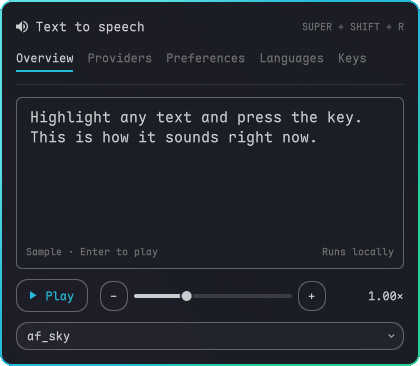
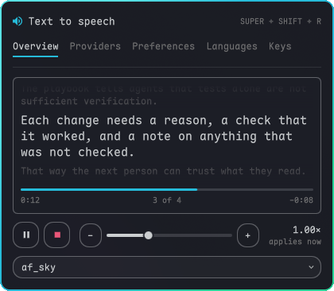
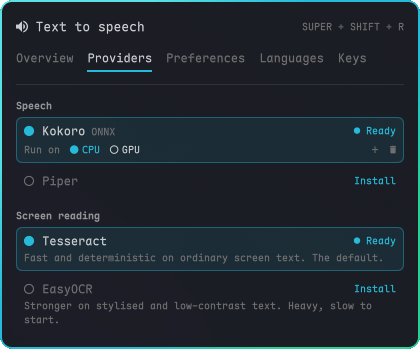
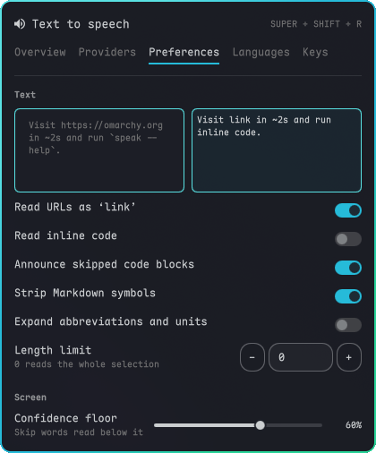
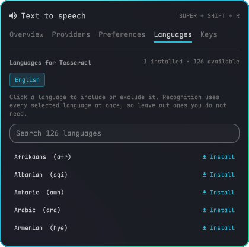
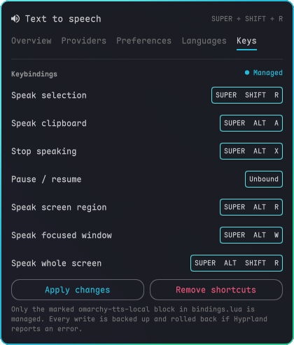

<h1 align="center">Omarchy TTS Local</h1>

<p align="center">
  <a href="https://github.com/jagrat7/omarchy-tts-local/pulls?q=is%3Apr+is%3Amerged"></a>
  <a href="https://omarchy.org/"></a>
  <a href="LICENSE"></a>
</p>

An Omarchy bar plugin that reads text aloud on a hotkey: the selection, the
clipboard, a copied image, the focused window, the whole monitor, or a region
you drag. Speech (Kokoro or Piper) and OCR (Tesseract or EasyOCR) run locally.

<p align="center">
  
</p>

## Features

<table>
  <tr>
    <td width="33%" valign="top"><b>A player</b><br>Follows the text sentence by sentence, with pause and live speed.<br><br></td>
    <td width="33%" valign="top"><b>Local voices</b><br>Kokoro on the CPU by default, Piper for slower PCs. No accounts.<br><br></td>
    <td width="33%" valign="top"><b>Clean text</b><br>Strips markdown and terminal codes, shortens URLs, with a live preview.<br><br></td>
  </tr>
  <tr>
    <td width="33%" valign="top"><b>Screen reading</b><br>Tesseract or EasyOCR, recognition languages and a confidence floor.<br><br></td>
    <td width="33%" valign="top"><b>Your own keys</b><br>Rebind every shortcut; changes roll back if Hyprland rejects them.<br><br></td>
    <td width="33%" valign="top"><b>Reads anything</b><br>Selection, clipboard, copied image, window, monitor or a dragged region.<br><br><b>Scriptable</b><br><code>speak</code> plays, pauses and changes speed from the command line.</td>
  </tr>
</table>

## Install

```bash
omarchy plugin add https://github.com/jagrat7/omarchy-tts-local.git --enable
```

Click the speaker icon in the bar. The first-run screen installs Kokoro, which
runs on the CPU (about 480 MB). If Kokoro can't run on this computer, the
screen says why and offers Piper instead. Shortcuts are set up from the Keys
tab, and other providers from the Providers tab.

## Uninstall

Remove the shortcuts from the Keys tab, then:

```bash
omarchy plugin remove io.github.jagrat7.omarchy-tts-local
```

Downloaded data stays in `~/.local/share/omarchy-tts-local`,
`~/.config/omarchy-tts-local` and `~/.cache/omarchy-tts-local`.

## Keys

| Key | Action |
|-----|--------|
| `SUPER+ALT+E` | Speak the selection (again to stop) |
| `SUPER+ALT+A` | Speak the clipboard, text or image |
| `SUPER+ALT+X` | Stop |
| `SUPER+ALT+R` | Drag a region and read it |
| `SUPER+ALT+W` | Read the focused window |
| `SUPER+ALT+SHIFT+R` | Read the focused monitor |

All of them can be changed on the Keys tab. Right-click the bar icon to speak
the selection or stop.

## Providers

| Provider | Download | Notes |
|----------|----------|-------|
| Kokoro ONNX | ~480 MB CPU, ~2.3 GB GPU | **Default and recommended.** Natural voices on the CPU, 27 English voices (American and British). The GPU option needs NVIDIA |
| Piper | ~230 MB, ~60 MB per extra voice | The fallback for weaker PCs and for languages other than English. 170+ voices in 50+ languages |
| Kokoro PyTorch | ~6 GB | Same voices, several seconds to start each time |

**What runs it.** Both engines need a 64-bit Intel or AMD processor with
SSE4.2: Intel from about 2009 (first-generation Core i3/i5/i7) and AMD from
about 2011 (Bulldozer, then every Ryzen). ARM computers aren't supported yet.
Setup checks this before downloading anything and says plainly if the
processor can't run them.

**Which to pick.** Kokoro's speed depends on how fast a single CPU core is,
not on how many cores there are. Any desktop Core i5 or Ryzen 5 from the last
several years makes speech several times faster than it plays. Low-power
Celeron, Pentium N-series and Atom chips may pause between sentences, so use
Piper there. Piper is also the choice when disk space is tight or you want a language
other than English.

Kokoro ONNX stays loaded for 10 idle minutes. Set
`speak --set .kokoro_onnx.keepWarm 0` to disable that. A provider is marked
Ready only after it has produced speech on this machine.

## Screen reading

| Engine | Notes |
|---|---|
| Tesseract | Default. Fast, 120+ language packs |
| EasyOCR | Better on stylised or low-contrast text. About 6 GB, slow to load per capture |

Words below `ocr.minConfidence` (default 60) are dropped instead of read; set
it to `0` to keep everything. Copied PNG, JPEG, WebP, BMP and TIFF images are
read through OCR. Capture works over fullscreen Steam/Proton games, though
that varies by game. The engine is chosen under Screen reading on the Providers
tab, the confidence floor is under Screen on the Preferences tab, and
recognition languages have their own Languages tab.

## Command line

```bash
speak "hello world"                # speak an argument
cat notes.md | speak               # speak stdin
speak --selection                  # the selection
speak --clipboard                  # clipboard text, or OCR a copied image
speak --snip                       # drag a region
speak --window                     # the focused window
speak --screen                     # the focused monitor
speak --stop                       # stop
speak --provider kokoro_onnx       # another provider for one run
speak --verify kokoro_onnx         # check a provider works, silently
speak --set .rate 1.2              # change a setting

speak-voice available              # list downloadable Piper voices
speak-voice add en_GB-alba-medium  # download one
speak-voice use en_GB-alba-medium  # make it the default
```

Text goes through [`lib/sanitize.py`](lib/sanitize.py) first, which strips
markdown, ANSI codes and box drawing and shortens URLs, paths and hashes. The
Preferences tab previews it.

Playback controls are also available from the CLI:

```bash
speak --pause             # mpv playback only; harmless when idle
speak --resume
speak --toggle-pause
speak --live-rate 1.25    # saves the next rate; reports applied: live or next
speak --now-playing       # bounded text, status, progress, capabilities as JSON
```

Raw audio uses mpv when installed, with pw-cat/aplay fallback. Pause and live
speed are unavailable with fallback players. Progress uses a normal-rate
content timeline; duration is estimated at 15 characters/second when unknown.
The Keys tab offers an unbound “Pause / resume” shortcut.

## Custom providers

Any executable that reads text on stdin and plays it. Put it in
`~/.config/omarchy-tts-local/providers/`; a file named like a bundled provider
replaces it.

```bash
#!/usr/bin/env bash
# title: My voice
# desc: my custom voice
exec my-tts-engine --voice "${TTS_VOICE:-default}" --speed "${TTS_RATE:-1.0}"
```

Providers get `TTS_VOICE`, `TTS_RATE`, `TTS_PLUGIN_DIR`, `TTS_CONFIG`,
`TTS_DATA_DIR`, `TTS_INPUT_CHARS` and `TTS_INPUT_BYTES`. With `TTS_SILENT=1`
the provider should synthesise without playing and exit 0 on success. OCR
engines go in `~/.config/omarchy-tts-local/ocr/`, reading a PNG on stdin and
printing text.

## Requirements

`bash`, `wl-clipboard`, `jq`, `python3`, `flock` and PipeWire or ALSA. Screen
reading also needs `tesseract`, `grim` and `slurp`; downloads use `curl`.
Pause and live speed need `mpv`. Engines are built with `uv`; if it is
missing, setup installs it with `pacman` through `pkexec`, as it does
Tesseract language packs, after asking for your password. `hyprpicker`
(freezes the screen while you drag a region) and `notify-send` (error
messages) are used when present. All are in Omarchy or the Arch repos.

## Privacy and security

Nothing you read or capture is sent anywhere; the network is only used for
downloads you start. Engines install from hash-pinned locks in
[`lib/engines/`](lib/engines), and models and voices are checked against
SHA-256 digests. See [SECURITY.md](SECURITY.md).

## Development

```bash
python3 -m unittest discover -s tests -v
shellcheck -x bin/speak bin/speak-voice providers/* ocr/* lib/*.sh
```

Symlink a clone into the plugin directory for hot reload:

```bash
git clone https://github.com/jagrat7/omarchy-tts-local.git
ln -s "$PWD/omarchy-tts-local" \
  "${XDG_CONFIG_HOME:-$HOME/.config}/omarchy/plugins/io.github.jagrat7.omarchy-tts-local"
```

Architecture notes are in [DEVELOPMENT.md](DEVELOPMENT.md).

## Credits

Fork of [hikari112/omarchy-tts](https://github.com/hikari112/omarchy-tts) by
Jesse Sanford, which this project builds on. Changes since the fork are in
the [merged pull requests](https://github.com/jagrat7/omarchy-tts-local/pulls?q=is%3Apr+is%3Amerged).
