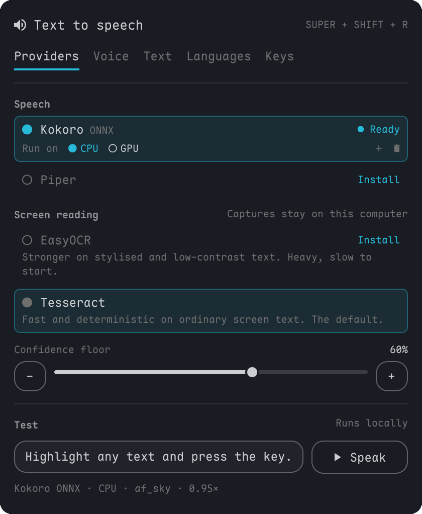

<h1 align="center">Omarchy TTS Local</h1>

<p align="center">
  <a href="CHANGELOG.md"></a>
  <a href="https://omarchy.org/"></a>
  <a href="LICENSE"></a>
</p>

An Omarchy bar plugin that reads text aloud on a hotkey: the selection, the
clipboard, a copied image, the focused window, the whole monitor, or a region
you drag. Speech (Piper or Kokoro) and OCR (Tesseract or EasyOCR) run locally.

<p align="center">
  
</p>

## Features

- Local only. No cloud providers, accounts or API keys, and nothing you read
  leaves the machine.
- Kokoro ONNX: about 480 MB instead of about 6 GB for Kokoro PyTorch, and it
  starts in under a second. Runs on CPU or an NVIDIA GPU.
- Providers tab: speech engines and the screen-reading (OCR) engine in one
  place. Both Kokoro engines share one row with a CPU/GPU switch. Engines
  install, test and uninstall from the panel.
- Engine downloads show their size first, show progress and can be
  cancelled. The ONNX CPU and GPU engines share one copy of the model files,
  and models are verified once rather than on every run.

## Install

```bash
omarchy plugin add https://github.com/jagrat7/omarchy-tts-local.git --enable
```

Click the speaker icon in the bar. The first-run screen installs Piper and one
voice (about 230 MB). Shortcuts are set up from the Keys tab, and Kokoro from
the Providers tab.

<details>
<summary>Upgrading from <code>io.github.hikari112.tts</code> or an older build</summary>

On first run, `~/.config/omarchy-tts`, `~/.local/share/omarchy-tts` and
`~/.cache/omarchy-tts` are moved to `omarchy-tts-local`, so engines, voices
and settings are kept. Remove the old plugin and press **Apply changes** on
the Keys tab to repoint the shortcuts. A selected cloud provider is switched
to Piper.

</details>

## Keys

| Key | Action |
|-----|--------|
| `SUPER+ALT+E` | Speak the selection (again to stop) |
| `SUPER+ALT+A` | Speak the clipboard, text or image |
| `SUPER+ALT+X` | Stop |
| `SUPER+ALT+R` | Drag a region and read it |
| `SUPER+ALT+W` | Read the focused window |
| `SUPER+ALT+SHIFT+R` | Read the focused monitor |

All of them can be changed on the Keys tab. Right-click the bar icon to speak
the selection or stop.

## Providers

| Provider | Download | Notes |
|----------|----------|-------|
| Piper | ~230 MB, ~60 MB per extra voice | Default. 170+ voices in 50+ languages |
| Kokoro ONNX | ~480 MB CPU, ~2.3 GB GPU | GPU needs NVIDIA |
| Kokoro PyTorch | ~6 GB | Same voices, several seconds to start each time |

Kokoro ONNX stays loaded for 10 idle minutes. Set
`speak --set .kokoro_onnx.keepWarm 0` to disable that. A provider is marked
Ready only after it has produced speech on this machine.

## Screen reading

| Engine | Notes |
|---|---|
| Tesseract | Default. Fast, 120+ language packs |
| EasyOCR | Better on stylised or low-contrast text. About 6 GB, slow to load per capture |

Words below `ocr.minConfidence` (default 60) are dropped instead of read; set
it to `0` to keep everything. Copied PNG, JPEG, WebP, BMP and TIFF images are
read through OCR. Capture works over fullscreen Steam/Proton games, though
that varies by game. The engine and confidence floor are under Screen reading
on the Providers tab; recognition languages have their own Languages tab.

## Command line

```bash
speak "hello world"                # speak an argument
cat notes.md | speak               # speak stdin
speak --selection                  # the selection
speak --clipboard                  # clipboard text, or OCR a copied image
speak --snip                       # drag a region
speak --window                     # the focused window
speak --screen                     # the focused monitor
speak --stop                       # stop
speak --provider kokoro_onnx       # another provider for one run
speak --verify kokoro_onnx         # check a provider works, silently
speak --set .rate 1.2              # change a setting

speak-voice available              # list downloadable Piper voices
speak-voice add en_GB-alba-medium  # download one
speak-voice use en_GB-alba-medium  # make it the default
```

Text goes through [`lib/sanitize.py`](lib/sanitize.py) first, which strips
markdown, ANSI codes and box drawing and shortens URLs, paths and hashes. The
Text tab previews it.

Playback controls are also available from the CLI:

```bash
speak --pause             # mpv playback only; harmless when idle
speak --resume
speak --toggle-pause
speak --live-rate 1.25    # saves the next rate; reports applied: live or next
speak --now-playing       # bounded text, status, progress, capabilities as JSON
```

Raw audio uses mpv when installed, with pw-cat/aplay fallback. Pause and live
speed are unavailable with fallback players. Progress uses a normal-rate
content timeline; duration is estimated at 15 characters/second when unknown.
The Keys tab offers an unbound “Pause / resume” shortcut.

## Custom providers

Any executable that reads text on stdin and plays it. Put it in
`~/.config/omarchy-tts-local/providers/`; a file named like a bundled provider
replaces it.

```bash
#!/usr/bin/env bash
# title: My voice
# desc: my custom voice
exec my-tts-engine --voice "${TTS_VOICE:-default}" --speed "${TTS_RATE:-1.0}"
```

Providers get `TTS_VOICE`, `TTS_RATE`, `TTS_PLUGIN_DIR`, `TTS_CONFIG`,
`TTS_DATA_DIR`, `TTS_INPUT_CHARS` and `TTS_INPUT_BYTES`. With `TTS_SILENT=1`
the provider should synthesise without playing and exit 0 on success. OCR
engines go in `~/.config/omarchy-tts-local/ocr/`, reading a PNG on stdin and
printing text.

## Requirements

`bash`, `wl-clipboard`, `jq`, `python3`, `flock` and PipeWire or ALSA. Screen
reading also needs `tesseract`, `grim` and `slurp`; downloads use `curl`. All
are in Omarchy or the Arch repos.

## Privacy and security

Nothing you read or capture is sent anywhere; the network is only used for
downloads you start. Engines install from hash-pinned locks in
[`lib/engines/`](lib/engines), and models and voices are checked against
SHA-256 digests. See [SECURITY.md](SECURITY.md).

## Remove

Remove the shortcuts from the Keys tab, then:

```bash
omarchy plugin remove io.github.jagrat7.omarchy-tts-local
```

Downloaded data stays in `~/.local/share/omarchy-tts-local`,
`~/.config/omarchy-tts-local` and `~/.cache/omarchy-tts-local`.
`speak-setup cleanup --yes` removes API keys left in the keyring by older
versions.

## Development

```bash
python3 -m unittest discover -s tests -v
shellcheck -x bin/speak bin/speak-voice providers/* ocr/* lib/*.sh
```

Symlink a clone into the plugin directory for hot reload:

```bash
git clone https://github.com/jagrat7/omarchy-tts-local.git
ln -s "$PWD/omarchy-tts-local" \
  "${XDG_CONFIG_HOME:-$HOME/.config}/omarchy/plugins/io.github.jagrat7.omarchy-tts-local"
```

Architecture notes are in [DEVELOPMENT.md](DEVELOPMENT.md).

## Credits

Fork of [hikari112/omarchy-tts](https://github.com/hikari112/omarchy-tts) by
Jesse Sanford, which this project builds on. Changes since the fork are in
[CHANGELOG.md](CHANGELOG.md).
